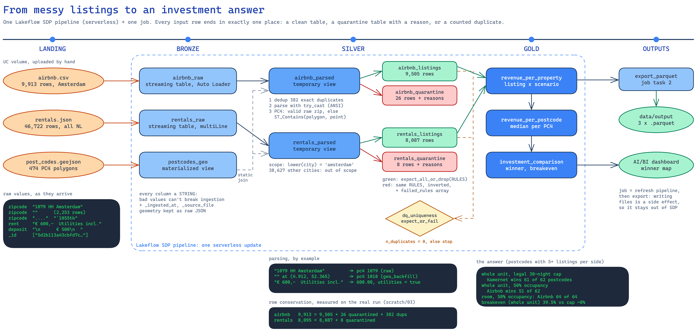

# Data quality: issues found and how they're handled

All numbers come from the real files (`scratch/01_explore_airbnb.py`, `scratch/02_explore_rentals.py`)
and from the deployed pipeline (`scratch/03_validate_outputs.py`).

## The principle: nothing disappears silently

Every in-scope input row ends in **exactly one** place:

```
Airbnb   9,913 bronze = 9,505 clean + 26 quarantined + 382 exact duplicates removed
Kamernet 8,095 in scope (Amsterdam) = 8,087 clean + 8 quarantined
         (38,627 rows from other cities are out of scope, not bad data)
```

This **row conservation** check is asserted in `scratch/03_validate_outputs.py` and, on fixtures,
in `tests/test_transforms.py`.



## Issues found

### Airbnb (`airbnb.csv`, 9,913 rows)

| Issue | Evidence | Handling |
|-------|----------|----------|
| Missing postcode | 2,253 empty (23%) | Point-in-polygon backfill (below) |
| Messy postcodes | `1079 HH Amsterdam`, `Nederland 1091 TS`, `` `1055tk ``, `342HUIS`, `....`, `b`, `0` | Regex `(?<![0-9])([1-9][0-9]{3})(?![0-9])` extracts a PC4 or NULL; tested on every shape seen |
| Exact duplicate rows | 382 | Removed on a row hash (NULLs are marked first, so `('a', NULL)` ≠ `(NULL, 'a')`) |
| Near-duplicates | 130 rows: same coordinates, type, guests and bedrooms; price within 5% | **Kept and documented**: identity can't be proven (apart-hotels) and the effect on medians is about 1.4% |
| Price errors | €9,000/night for 2 guests with no reviews; €8,131; €7,783 | Quarantined by `price_in_bounds` (€10–€5,000) |
| Expensive but real | 20 listings at €2,000–€4,000: 3–4 bedrooms, rated 95–100 | **Kept**: they're unusual, not wrong |
| Missing bedrooms / reviews | 14 / 1,711 | Warn-only expectations (not needed for revenue) |

### Kamernet (`rentals.json`, 46,722 rows)

| Issue | Evidence | Handling |
|-------|----------|----------|
| Whole country | 8,095 Amsterdam rows | Scope filter `lower(trim(city)) = 'amsterdam'`, which also catches the one `amsterdam` row |
| Rent as text | `€ 600,-  Utilities incl.` | `parse_eur` (amount) + `utilities_included` (flag) |
| Implausible rents | three at €1, one at €50 | Quarantined by `rent_in_bounds` (€100–€10,000) |
| "Missing" spelled five ways | `NA`, `-`, `""`, NULL, and **values wrapped in newlines** (`"\n   -\n"`) | `normalise_null` strips all whitespace: Spark's `trim` only removes spaces |
| Mongo-style arrays | `_id: ["5d2b…"]` | `element_at(_id, 1)`; uniqueness enforced by `dq_uniqueness` |
| Anti-squat listings | 3 | Not a market rent, so quarantined by `segment_known` |
| City vs postcode conflict | The lowercase `amsterdam` row has postcode 1181 (Amstelveen) | Quarantined by `pc4_in_amsterdam`: a visible reason instead of a silent filter |

## Backfill strategy for missing postcodes (implemented)

1. **Parse** the raw zip to a PC4.
2. **Locate** every listing in a PC4 polygon with `ST_Contains(ST_GeomFromGeoJSON(polygon), ST_Point(lon, lat, 4326))`.
   It's a broadcast join: 474 polygons × ~10k points.
3. **Resolve**: if the raw PC4 is a valid Amsterdam postcode, keep it; otherwise use the polygon.

**Why raw first?** Raw and polygon disagree for 1,616 of 7,629 valid zips (21%). Measuring the
distance from each point to its raw postcode's polygon showed a **median of 66 m, 85% within
200 m** and only 21 beyond 1 km. That's Airbnb's deliberate location fuzzing, not wrong
postcodes. Every row keeps `pc4_source` (`raw` / `geo_backfill`) and `pc4_geo_mismatch`, so the
choice stays inspectable.

**Result:** 99.76% of Airbnb rows end with an Amsterdam PC4 (7,609 raw + 1,922 backfilled).

## Quality rules (`src/airbnb_renting/quality.py`)

| Table | Drop + quarantine | Warn only |
|-------|-------------------|-----------|
| `airbnb_listings` | `coordinates_parsed`, `pc4_not_null`, `pc4_in_amsterdam`, `price_parsed`, `price_in_bounds`, `segment_known` | `bedrooms_present`, `review_score_present` |
| `rentals_listings` | `pc4_not_null`, `pc4_in_amsterdam`, `rent_parsed`, `rent_in_bounds`, `segment_known` | `area_present` |
| `dq_uniqueness` | `unique_listing_id` → **fails the update** (a duplicate key means broken logic, not a bad row) | |

Two design rules make the quarantine trustworthy:
- **NULL-safe rules** (`coalesce(rule, false)`). In SQL, `NULL BETWEEN 10 AND 5000` is NULL. The
  expectation would drop the row and `NOT rule` wouldn't select it either, so it would vanish.
- **One rule checks one thing** (`price IS NULL OR price BETWEEN …`), so a missing price gives one
  reason (`price_parsed`), not two.

## Known limitations

- **Reference-data quirk:** the GeoJSON labels PC4 **1112** as Amsterdam, but its streets (e.g.
  Carel Willinkgracht) are in Diemen. Kamernet's `city` field is right for those 123 rows, so
  rentals keep the city as scope; Airbnb listings in 1112 count as Amsterdam.
- **Not ordered:** `dq_uniqueness` fails the update loudly, but gold views refreshed in the same
  update before the failure are not rolled back.
- **Static data:** `dropDuplicates` keeps the seen ids as streaming state. That's fine for one
  static file; continuous ingestion would need a watermark.
