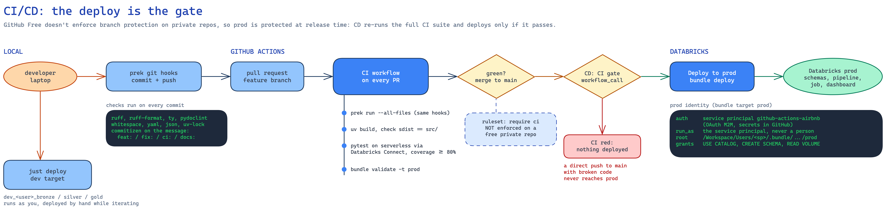

# Development

## Project structure

```
databricks.yml                  bundle: artifacts (wheel), variables, dev/prod targets
resources/                      pipeline, job, schemas + export volume, dashboard
notebooks/pipelines/airbnb_renting/transformations/
                                SDP source: 01_bronze … 05_gold (thin: wire inputs to the package)
notebooks/export_parquet.py     job task 2: gold → parquet in a volume
src/airbnb_renting/             the package: config, parsing, segments, quality, geo, transforms, revenue
tests/                          pytest on serverless via Databricks Connect (+ fixtures/)
scratch/                        capability probe, exploration, output validation
data/                           raw zips (inputs) and output/ (exported parquet)
docs/                           the "why", plus diagrams
.github/                        CI (PRs) and CD (main), deploy action
.just/, .justfile               task recipes
```

## Day to day

| Task | Command |
|------|---------|
| Set up (uv env, git hooks) | `just setup` |
| Lint, types, docstrings | `just lint` (or `uv run prek run --all-files`, exactly what CI runs) |
| Unit tests (serverless) | `just test` |
| Deploy your dev copy | `just deploy` |
| Run the workflow (pipeline, then export) | `just run` |
| Pull exports into `data/output/` | `just export` |
| Run a scratch notebook locally | `just scratch 03_validate_outputs` |
| Validate the bundle | `just validate` / `just validate prod` |

`just` reads `PROFILE_NAME` from a local, git-ignored `.env`:

```
PROFILE_NAME=<your databricks profile>
DATABRICKS_CONFIG_PROFILE=<your databricks profile>
```

## Tests run on serverless

`tests/conftest.py` creates one `DatabricksSession.builder.serverless(True)` for the whole session,
so every test runs on the same engine as the pipeline. Two consequences:
- each `.collect()` is a network round trip, so tests send all cases in **one** DataFrame (the
  `evaluate` fixture);
- the server can't see local files, so fixtures are read in Python and sent with `createDataFrame`.

`databricks-connect` must match the serverless runtime (pinned `19.2.*` for DBR 19.9). It can't be
installed alongside plain `pyspark`.

## Gotchas met during the build

| Symptom | Cause | Fix |
|---------|-------|-----|
| `CAST_INVALID_INPUT: '' cannot be cast to INT` | Spark 4 is ANSI by default; `regexp_extract` returns `''` on no match | `try_cast` |
| `ModuleNotFoundError: airbnb_renting` from plain Python (pytest fine) | uv marks `.venv` hidden on macOS; Python ≥ 3.12.4 skips hidden `.pth` files | `just scratch …` uses a non-editable install |
| `PlanMetrics is not JSON serializable` in the export | Spark Connect's `toPandas()` puts metrics in `df.attrs`; `to_parquet` serialises attrs | `pdf.attrs = {}` |
| Schemas named `dev_<user>_dev_bronze` | `mode: development` already prefixes | Removed the custom prefix |
| Hook passes but CI fails (or the reverse) | Two different lists of checks | CI runs `prek run --all-files` |
| `ruff` lints `scratch/` only in hooks | Hooks pass files explicitly, which bypasses `extend-exclude` | `force-exclude = true` |

## Deployment

| Target | Who deploys | Identity | Schemas |
|--------|-------------|----------|---------|
| `dev` | you, with `just deploy` | you | `dev_<user>_bronze/silver/gold` |
| `prod` | CD on push to `main`, after the CI gate | service principal `github-actions-airbnb` | `bronze/silver/gold` |



The landing zone (`airbnb_renting.landing.raw`) isn't part of the bundle. It's created once with
`just bootstrap`, so `bundle destroy` can never delete the uploaded raw files.
